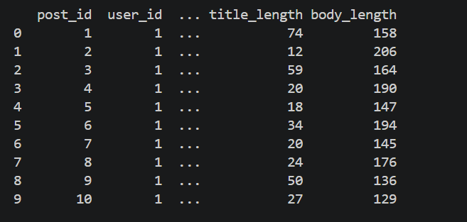

# scripts — парсинг данных

## Что делает
Скрипт `read_api.py` обращается к публичному API
[JSONPlaceholder](https://jsonplaceholder.typicode.com/posts)
и собирает датасет из 100 постов.

## Источник данных
- URL: `https://jsonplaceholder.typicode.com/posts`
- Метод: `GET`
- Формат ответа: JSON-массив объектов

## Что попадает в датасет
| Столбец | Описание | Тип |
|---|---|---|
| `post_id` | ID поста | int |
| `user_id` | ID автора | int |
| `title` | Заголовок поста | str |
| `body` | Текст поста | str |
| `title_length` | Длина заголовка (символов) | int |
| `body_length` | Длина тела (символов) | int |

## Как запустить
```bash
pip install -r ../requirements.txt
python read_api.py
```

Результат сохраняется в `posts.csv` (не коммитится).

## Формат вывода
Скрипт загружает данные в `pandas.DataFrame` и выводит первые 10 строк
через `df.head(10)`.

## Скриншот вывода

